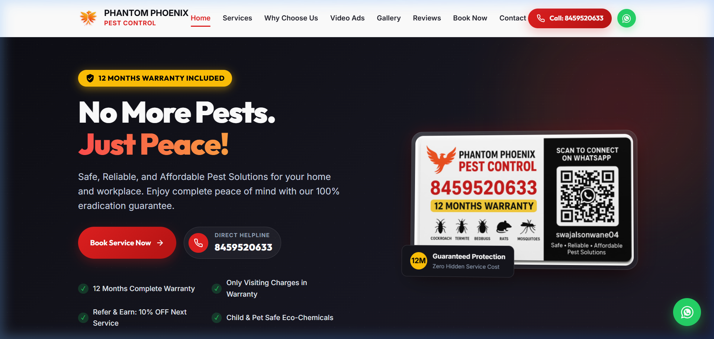
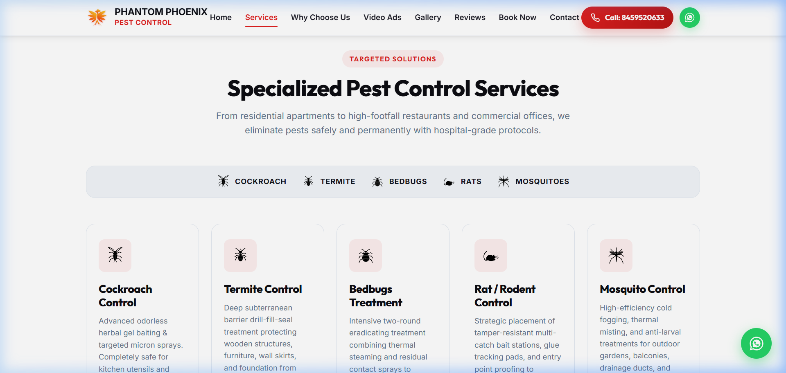
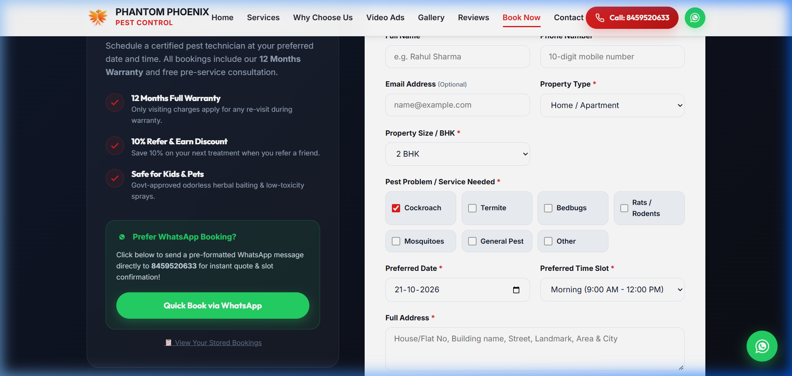
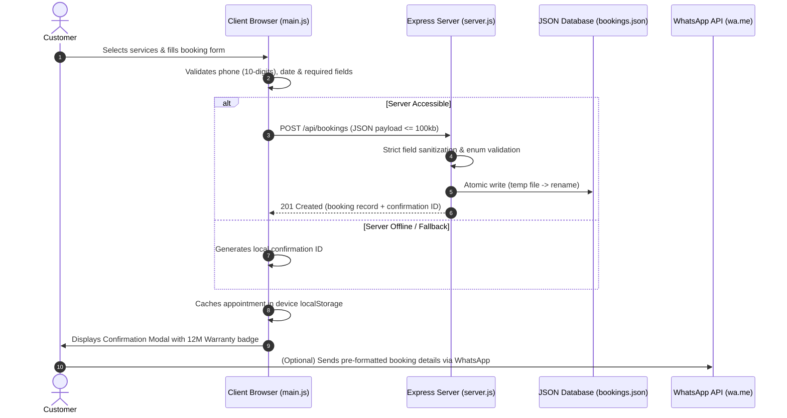

# Phantom Phoenix Pest Control — Client Website & Booking Platform

[](https://github.com/Vaibhav-Waghalkar)
[](https://dev-vaibhav-ai.co.in/)
[](https://github.com/Vaibhav-Waghalkar/Phantom-Phoenix-Website)
[](LICENSE)
[](https://nodejs.org/)
[](https://expressjs.com/)
[](#-ui-previews)

> **Client Project Attribution**:  
> This production-ready website and reservation platform was designed and developed by **[Vaibhav Waghalkar](https://github.com/Vaibhav-Waghalkar)** for **Phantom Phoenix Pest Control**, a professional pest eradication business.  
> The project is hosted on my personal GitHub account as part of my software engineering portfolio. *Phantom Phoenix Pest Control is the client organization and retains business ownership of its branding and services.*

---

## 📸 UI Previews

### 1. Hero & Navigation Section
Sleek dark theme featuring brand identity, prominent 12 Months Warranty trust badges, instant click-to-call (`8459520633`), WhatsApp inquiry integration, and direct booking call-to-actions.



---

### 2. Specialized Services & Pricing Cards
Structured service breakdown for Cockroaches, Termites, Bedbugs, Rodents, and Mosquitoes, detailing treatment techniques, warranty coverage, transparent rates, and direct *"Book This Service"* pre-selection triggers.



---

### 3. Interactive Online Booking System
Dynamic reservation form with property type and size toggles, multiple pest category selections, datepicker restricted to future dates (today onwards), time slot scheduling, and dual storage synchronization.



---

## 📌 Project Overview & Client Requirements

Phantom Phoenix Pest Control required a modern, high-converting digital presence to replace manual telephone-only bookings with an intuitive online reservation workflow.

### Core Business Objectives:
1. **Brand Credibility & Trust**: Establish high customer confidence with bold visual branding, verified service protocols, customer testimonials, and prominent 12-month warranty guarantees.
2. **Frictionless Appointment Scheduling**: Empower residential and commercial clients to book certified pest technicians 24/7 in under 60 seconds.
3. **Omnichannel Communication**: Connect web submissions directly to telephone dispatch and WhatsApp messaging with pre-formatted appointment summaries.
4. **Resilient Data Capture**: Ensure booking requests are never lost, combining an Express.js backend with automatic client-side `localStorage` caching during offline or network interruptions.

---

## ✨ Verified Features & Implementation

- **🎨 Modern Dark-Mode Design System**:
  - Custom color palette with deep dark backgrounds (`#0a0d14`), crimson ember accents (`#e02020`), and gold warranty tags (`#f59e0b`).
  - Fluid typography powered by Google Fonts (Outfit, Inter, Space Grotesk).
  - Glassmorphic card styling, sticky navigation with scrollspy, and mobile hamburger menu.
- **⚡ Dynamic Booking Workflow**:
  - Interactive service pre-selection: Clicking "Book This Service" on any treatment card automatically selects the pest type and smoothly scrolls to the form.
  - Strict input validation: Name length checks, sanitized 10-digit phone enforcement, ISO date (`YYYY-MM-DD`) format verification, and address requirements.
  - Smart date constraints: Prevents past date selection by dynamically computing `min` date restrictions.
- **🛡️ Secure Booking API & Reliability**:
  - **Payload Size Limits**: Strict 100kb request body limits to prevent payload abuse.
  - **Server-Side Validation & Sanitization**: Whitelist validation for property types, time slots, and pest types; truncation of input lengths to prevent buffer exhaustion.
  - **Atomic File Writing**: Double-buffered temporary write and rename pattern to prevent JSON corruption during concurrent operations.
  - **Administrative Protection**: Optional `ADMIN_API_KEY` header protection on `GET /api/bookings` to safeguard customer contact details from public web scrapers.
  - **Privacy-Preserving History**: Frontend booking history modal renders appointments stored on the user's local device, preventing cross-tenant customer data leakage.
- **📱 One-Tap WhatsApp & Phone Integrations**:
  - Pre-filled WhatsApp URLs formatted with appointment metadata (Client Name, Phone, Property Type, Pest Types, Date, Time Slot, Address).
  - Click-to-call telephone links for immediate emergency pest consultations.
- **🖼️ Rich Media & Showcase**:
  - Responsive video ad players for promotional creatives.
  - Categorized image gallery with interactive category filters (All, Residential, Commercial, Termites) and modal Lightbox viewer.

---

## 🛠️ Technology Stack

| Domain | Technology / Library | Role in Project |
| :--- | :--- | :--- |
| **Frontend UI** | HTML5 Semantic Markup | Accessible, SEO-friendly page structure |
| **Styling** | Vanilla CSS3 | Custom design system, CSS Grid, Flexbox, glassmorphic UI |
| **Client Logic** | Vanilla JavaScript (ES6+) | Form validation, scrollspy, modal dialogs, WhatsApp URL builder |
| **Backend** | Node.js (v18+) & Express.js (v4) | RESTful API routes, request sanitization, static file serving |
| **Storage Layer** | JSON File Store (`bookings.json`) | Lightweight, zero-config server persistence with atomic writes |
| **Offline Cache** | Browser `localStorage` | Client-side fallback ensuring seamless booking retention |
| **Typography** | Google Fonts (Outfit, Inter, Space Grotesk) | Clean, high-readability modern typography |

---

## 🏗️ Architecture & Booking Data Flow



---

## 📂 Project Directory Structure

```
Phantom Phoenix - Pest Control/
├── .gitignore                   # Excludes node_modules, env files, logs & OS artifacts
├── LICENSE                      # Official MIT License
├── README.md                    # Project documentation & developer portfolio showcase
├── package.json                 # Project configuration, scripts, engines & dependencies
├── package-lock.json            # Deterministic dependency lockfile
├── server.js                    # Express.js REST server & sanitized booking endpoints
├── index.html                   # Semantic, responsive single-page application
│
├── css/
│   └── style.css                # CSS variables, typography, layout & responsive queries
│
├── js/
│   └── main.js                  # Frontend interactions, validation, modals & WhatsApp sync
│
├── data/
│   └── bookings.json            # Server-side booking records (atomic JSON store)
│
├── screenshots/                 # High-resolution UI captures referenced in README
│   ├── 01_hero_section.png      # Hero banner, navbar & warranty badges
│   ├── 02_services_section.png  # Treatment cards & pricing tiers
│   └── 03_booking_section.png   # Dynamic appointment booking form
│
├── assets/
│   ├── icons/                   # Custom SVG icons (phoenix logo, termite, cockroach, etc.)
│   ├── images/                  # High-res gallery & service photography
│   └── videos/                  # Promotional MP4 video creatives
│
└── Images/                      # Client source promotional media
```

---

## 🚀 Getting Started

### Prerequisites

- **[Node.js](https://nodejs.org/)**: Version `18.0.0` or higher
- **[npm](https://www.npmjs.com/)**: Version `8.0.0` or higher (packaged with Node.js)
- Modern web browser (Chrome, Edge, Firefox, Safari)

### Installation & Local Run

1. **Clone the repository**:
   ```bash
   git clone https://github.com/Vaibhav-Waghalkar/Phantom-Phoenix-Website.git
   cd Phantom-Phoenix-Website
   ```

2. **Install project dependencies**:
   ```bash
   npm install
   ```

3. **Start the application**:
   ```bash
   npm start
   ```
   *For local development with automatic file restart:*
   ```bash
   npm run dev
   ```

4. **Access the application**:
   - Open your browser at: `http://localhost:3000`
   - Test the booking form and explore the responsive layout across viewports.

---

## 📡 API Documentation

### 1. Create a New Booking
- **Endpoint**: `POST /api/bookings`
- **Content-Type**: `application/json`
- **Request Body Limits**: `100kb`
- **Description**: Validates, sanitizes, and records a customer booking into `bookings.json`.

#### Fictional Example Payload:
```json
{
  "fullName": "Aarav Sharma",
  "phone": "9876543210",
  "email": "aarav.sharma@example.com",
  "propertyType": "Home",
  "propertySize": "3 BHK",
  "pestTypes": ["Cockroach Control", "Termite Treatment"],
  "preferredDate": "2026-11-15",
  "preferredTimeSlot": "Morning (9:00 AM - 12:00 PM)",
  "address": "Flat 304, Green Heights, MG Road, Pune",
  "notes": "Requesting odorless, pet-safe gel formulation for kitchen cabinets."
}
```

#### Successful Response (`201 Created`):
```json
{
  "success": true,
  "message": "Thanks Aarav Sharma! Your booking for 2026-11-15 at Morning (9:00 AM - 12:00 PM) is confirmed. We'll call you shortly on 9876543210.",
  "booking": {
    "id": "PHX-MUCXZ01A-482",
    "fullName": "Aarav Sharma",
    "phone": "9876543210",
    "email": "aarav.sharma@example.com",
    "propertyType": "Home",
    "propertySize": "3 BHK",
    "pestTypes": ["Cockroach Control", "Termite Treatment"],
    "preferredDate": "2026-11-15",
    "preferredTimeSlot": "Morning (9:00 AM - 12:00 PM)",
    "address": "Flat 304, Green Heights, MG Road, Pune",
    "notes": "Requesting odorless, pet-safe gel formulation for kitchen cabinets.",
    "warranty": "12 Months Warranty Included",
    "status": "Confirmed",
    "createdAt": "2026-10-20T11:00:00.000Z"
  }
}
```

---

### 2. Retrieve All Bookings (Administrative)
- **Endpoint**: `GET /api/bookings`
- **Authorization**: Protected via `x-admin-key` header (when `ADMIN_API_KEY` is configured in environment)
- **Description**: Returns all recorded bookings for dispatch and technician scheduling.

```bash
curl -H "x-admin-key: YOUR_SECRET_ADMIN_KEY" http://localhost:3000/api/bookings
```

---

## 💡 Development Highlights & Engineering Practices

- **Zero-Dependency Frontend**: Fast page load times and zero build-step overhead achieved using vanilla HTML, modern CSS, and lightweight JavaScript.
- **Fail-Safe Booking Architecture**: If the backend is temporarily unavailable, client-side resilience logic automatically captures the booking in browser storage and prepares a complete WhatsApp dispatch message.
- **Defensive API Engineering**: Implemented strict length bounds, ISO date validation, atomic temporary file swaps, and protected administrative routes to prevent data leakage.
- **Conversion-Focused UX**: Sticky navigation, scroll-synced active links, and deep WhatsApp integration maximize lead conversion rates for local business operations.

---

## 🔮 Potential Future Enhancements

- [ ] **SMS Gateway Integration**: Automated SMS booking confirmation via Twilio or MSG91.
- [ ] **Database Migration**: Optional migration from JSON file store to MongoDB / PostgreSQL for multi-region operations.
- [ ] **Technician Portal**: Role-based authentication portal for field technicians to update service status and warranty certificates.
- [ ] **Automated Testing Suite**: Integration tests using Playwright or Jest for end-to-end form submission flows.

---

## 📞 Client Business Contact

- **Business Name**: Phantom Phoenix Pest Control
- **Customer Helpline**: [+91 84595 20633](tel:8459520633)
- **WhatsApp Support**: [Direct WhatsApp Chat](https://wa.me/918459520633)
- **Service Guarantee**: 12 Months Warranty on Specialized Pest Treatments

---

## 👨‍💻 Developer Profile & Attribution

**Designed and developed by Vaibhav Waghalkar for Phantom Phoenix Pest Control.**

- **GitHub Profile**: [@Vaibhav-Waghalkar](https://github.com/Vaibhav-Waghalkar)
- **Project Repository**: [Phantom-Phoenix-Website](https://github.com/Vaibhav-Waghalkar/Phantom-Phoenix-Website)
- **Personal Portfolio**: [dev-vaibhav-ai.co.in](https://dev-vaibhav-ai.co.in/)

---

## 📄 License

This repository and code are made available under the **[MIT License](LICENSE)**.  
*Branding, trade names, and media assets belong to their respective client owners.*
